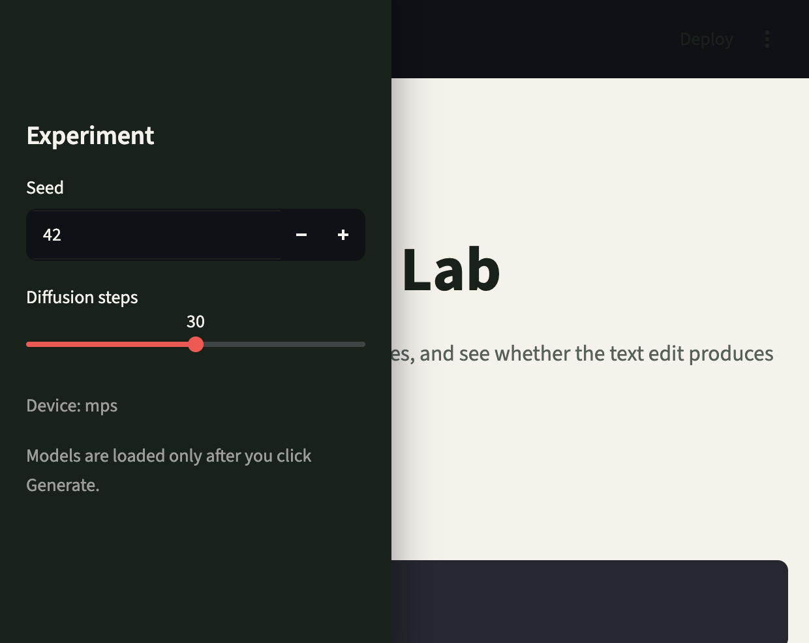
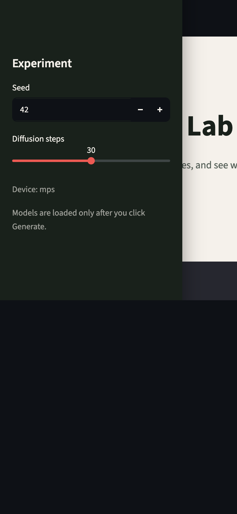

# Prompt Delta Lab

Prompt Delta Lab is a small research tool for studying how a change in a text prompt changes an image generated by a diffusion model.

It combines:

- Stable Diffusion image generation
- CLIP text and image embeddings
- Prompt similarity and image similarity
- Prompt-image alignment change
- Word-level prompt-change reports
- Reproducible tables and plots
- A Streamlit GUI for interactive two-prompt experiments

The project is designed as an educational tool: it makes prompt changes measurable and visible, while keeping the limits of the measurements explicit.

## Quick Start

Use Python 3.10+ and install the dependencies:

```bash
python3 -m venv .venv
source .venv/bin/activate
pip install -r requirements.txt
```

Launch the interactive GUI:

```bash
python3 -m streamlit run gui_app.py
```

Enter an original prompt and a changed prompt, then click **Generate comparison**. The GUI generates both images and displays:

- CLIP prompt similarity
- CLIP image similarity
- Image-text alignment change
- A plot of overall prompt change versus image change
- The words added, removed, or replaced between the prompts

## GUI Screenshots

### Prompt Entry



The desktop view provides two prompt workspaces: **Original prompt** and **Changed prompt**. Each accepts typed text or an uploaded `.txt` file. The sidebar controls the random seed and diffusion steps, so experiments can be repeated with the same generation settings. **Generate comparison** starts the Stable Diffusion and CLIP pipeline.

On a narrow screen, the same controls stack into a mobile-friendly layout:



### Results After Generation

After generation, the app adds two generated images followed by four CLIP measurements:

- **Prompt similarity**: similarity between the two prompt embeddings.
- **Image similarity**: similarity between the two image embeddings.
- **Image-text delta**: how the changed prompt-image alignment differs from the base pair.
- **Base alignment**: alignment between the original prompt and original image.

The results section also contains a two-part graph. The first panel compares overall prompt movement with image movement. The second lists the words added, removed, or replaced between the prompts and associates them with the measured alignment shift. This word view describes the complete prompt edit; it is not a causal test of each word in isolation.

## Reproduce the Research Dataset

The checked-in dataset is under `data/Dataset/`. To build a new run from prompts:

```bash
python3 generate_images.py
python3 build_embeddings.py
python3 analyze_embeddings.py
python3 analyze_prompt_word_changes.py
python3 -m plots.plot_similarity_bars
python3 -m plots.plot_word_impacts
```

The first command downloads and runs `runwayml/stable-diffusion-v1-5`. The CLIP step downloads `openai/clip-vit-large-patch14`. Model downloads require network access and several gigabytes of disk space.

For a different dataset location:

```bash
python3 -m plots.plot_similarity_bars --dataset-root data/Dataset
python3 -m plots.plot_word_impacts --dataset-root data/Dataset
```

## Project Layout

```text
.
├── README.md
├── requirements.txt
├── gui_app.py                         Interactive two-prompt tool
├── dataset_prompts.py                 Base prompts and variations
├── generate_images.py                 Stable Diffusion generation
├── build_embeddings.py                CLIP text/image embeddings
├── analyze_embeddings.py              Similarity and alignment metrics
├── analyze_prompt_word_changes.py     Word-level prompt changes
├── plots/
│   ├── plot_similarity_bars.py        Per-category similarity charts
│   └── plot_word_impacts.py           Aggregate word-impact charts
├── data/Dataset/                      Full generated research dataset
├── results/tables/                    CSV tables copied for easy browsing
├── examples/                          Curated images and graphs
└── docs/                              Methodology and artifact guide
```

## Understanding the Scores

For a base prompt/image pair and a variation prompt/image pair:

- **Prompt similarity** is cosine similarity between the two CLIP text embeddings. Higher means the prompts are closer in CLIP text space.
- **Image similarity** is cosine similarity between the two CLIP image embeddings. Higher means the generated images are visually closer in CLIP image space.
- **Base alignment** is the CLIP similarity between the base prompt and base image.
- **Variation alignment** is the CLIP similarity between the changed prompt and changed image.
- **Image-text delta** is variation alignment minus base alignment. A negative value means the changed prompt/image pair aligned less well than the base pair.

These are model-space measurements, not human judgments or percentages.

## Examples

The strongest positive alignment example in the saved run is the close-up portrait category, variation 04, with a delta of `+0.093`. The strongest negative example is the fantasy/sci-fi category, variation 02, with a delta of `-0.097`.

See [docs/EXAMPLES.md](docs/EXAMPLES.md) for the prompts, metrics, and interpretation, and [docs/METHODOLOGY.md](docs/METHODOLOGY.md) for the caveats.

## License and Model Terms

This repository contains code and derived research artifacts. Before publishing generated images or model outputs, check the license and usage terms of the Stable Diffusion and CLIP checkpoints used by your installation.
