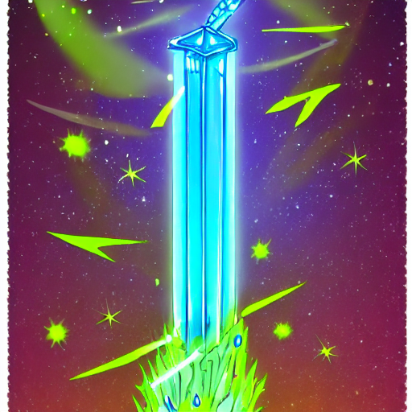
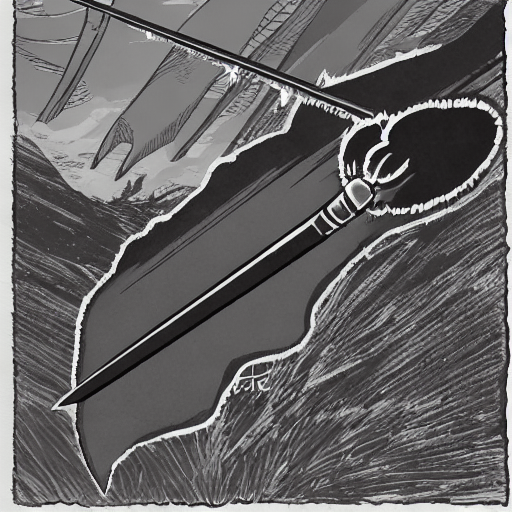

# Saved Examples

These examples are copied from the checked-in run in `data/Dataset/`. The source tables remain available in `results/tables/`.

## Strongest Positive Alignment Change

**Category:** `2_close_up_portrait`

**Base prompt:**

> A close-up studio portrait of a smiling woman with long brown hair

**Variation:**

> A close-up studio portrait of a smiling woman with long brown hair in neon cyberpunk lighting

**Metrics:**

- Prompt similarity: `0.743`
- Image similarity: `0.686`
- Base alignment: `0.242`
- Variation alignment: `0.335`
- Image-text delta: `+0.093`

[Per-category graph](../examples/graphs/portrait_similarity_delta_chart.png)

The prompt moves substantially in text space and the new prompt/image pair has higher CLIP alignment than the base pair.

## Strongest Negative Alignment Change

**Category:** `9_fantasy_sci_fi`

**Base prompt:**

> A detailed illustration of a glowing crystal sword floating in the air

**Variation:**

> A detailed illustration of a dark shadowy sword floating in the air

**Metrics:**

- Prompt similarity: `0.802`
- Image similarity: `0.712`
- Base alignment: `0.337`
- Variation alignment: `0.240`
- Image-text delta: `-0.097`

[Per-category graph](../examples/graphs/fantasy_similarity_delta_chart.png)

The prompt remains moderately similar in CLIP text space, but the changed prompt/image pair is much less aligned than the base pair.

## Aggregate Word Results

[Words with the biggest measured average changes](../examples/graphs/word_impact_biggest_changes.png)

[Words with the smallest measured average changes](../examples/graphs/word_impact_smallest_changes.png)

These charts summarize whole prompt/image changes associated with changed words. They are not causal single-word measurements; see [METHODOLOGY.md](METHODOLOGY.md).
